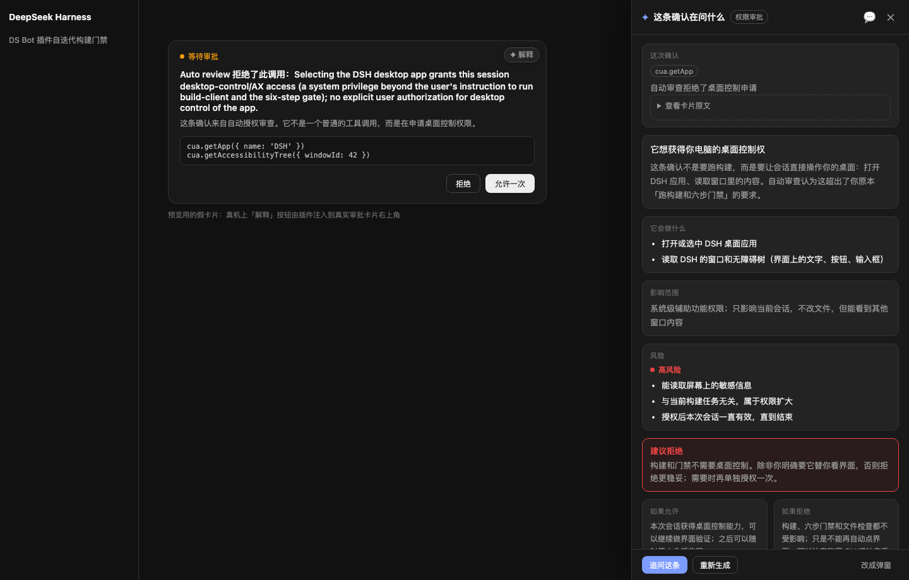

# 确认解释（dsh-confirm-explain）

> 任务：DSH 任务确认翻译插件　|　批次：确认解释插件源码_批次1　|　版本：v1.0.0
> 生成时间：2026-11-17 10:25　|　平台：macOS / DSH Web

把 DSH 的权限审批、选择题、计划评审翻译成普通人能听懂的话：卡片右上角一个「解释」按钮，点开后右侧抽屉（或居中弹窗）给出**它会做什么、影响什么、风险多大、建议放行还是拒绝、允许/拒绝后分别会怎样**，并带一个可拖动缩放的独立小窗，继续追问这条判断。

解释只供参考：插件不会替你点「允许」，也不修改 DSH 的审批策略。

## 功能

- **卡片内注入**：在真实审批卡片（`data-approval-key`）和提问卡片（`data-question-key`）右上角注入「✦ 解释」，不改变原卡片布局与按钮。
- **结构化解释**：一次模型调用返回 JSON，面板按「一句话 / 它会做什么 / 影响范围 / 风险 / 建议 / 如果允许 / 如果拒绝 / 原文没说清的」分区展示。
- **两种展示位置**：右侧抽屉（默认，不挡输入框）或居中弹窗；设置里随时切换，立即生效并持久化。
- **独立追问小窗**：可拖动、可缩放，保留本次确认的上下文；关掉再开不丢对话（同一次确认内）。
- **自动/手动**：可关掉「打开时自动解释」，先看卡片，点「生成解释」再花额度。
- **回落入口**：卡片注入失败、或关闭注入时，会话标题栏出现「✦ 解释」按钮。
- **结束标记**：确认被处理后再打开，会标注「已经处理过」，避免把旧解释当成新请求。
- **本机配置**：`~/.dsh/confirm-explain/config.json`；卡片原文只在本次模型调用中发送，不落盘。

## 安装

插件由宿主半边（HTTP + 模型调用）和浏览器半边（注入 + 面板）组成，需要装进 DSH 的 profile 并重启应用。

桌面版 profile 由 Electron 独占管理，CLI 的 `dsh plugin --profile desktop` 会被拒绝，所以用附带的 Node 安装器（会先备份 package.json 与 pnpm-lock.yaml）：

    node scripts/install-into-profile.mjs            # 装到 ~/.dsh/profiles/desktop
    node scripts/install-into-profile.mjs --dry-run  # 只看计划
    ./scripts/install-desktop.sh                     # 同上，薄封装

安装器做三件事（幂等）：

1. package.json 增加 `dependencies["@local/dsh-confirm-explain"] = "link:<本包>"`
2. `node_modules/@local/dsh-confirm-explain` 指向本包
3. package.json 的 `dsh.profile.bundles` 追加本包

然后重启 DeepSeek Harness（宿主半边）并刷新页面（浏览器半边）。

安装后打开任意会触发审批/提问的会话：卡片右上角应出现「✦ 解释」。

## 设置

「设置 → 确认解释」提供：

| 项 | 默认 | 说明 |
|---|---|---|
| 展示方式 | 右侧抽屉 | 抽屉 / 居中弹窗 |
| 打开时自动解释 | 开 | 关掉后先显示「生成解释」 |
| 在确认卡片上显示「解释」 | 开 | 关掉后入口移到标题栏 |
| 同时打开追问小窗 | 关 | 打开面板时顺带展开小窗 |
| 解释详细度 | 标准 | 简明更省 token，标准更完整 |

配置写入 `~/.dsh/confirm-explain/config.json`（0600，目录 0700）。

## 宿主接口

前缀 `/_dsh/confirm-explain`：

| 方法 | 路径 | 说明 |
|---|---|---|
| GET | `/health` | 版本与存活 |
| GET | `/config` | 当前配置 |
| POST | `/config` | 合并配置（校验白名单，原子写） |
| POST | `/explain` | 一条确认的结构化解释 |
| POST | `/chat` | 针对同一条确认的追问 |

POST 只接受 `application/json`，拒绝跨站 Origin；请求体上限 256KB；`/explain` 对并发相同请求去重。

模型走 DSH 当前默认模型（`ctx.agentDefaultModel.currentSelection()`）和 `ctx.llm.stream()`，不另存 API Key。

## 配置项（cordis.patch.yml）

| 字段 | 默认 | 说明 |
|---|---|---|
| `dataDir` | `~/.dsh/confirm-explain` | 配置目录 |
| `maxTokens` | 1800 | 单次解释输出上限 |
| `timeoutMs` | 90000 | 单次模型调用超时 |

## 目录

    dsh-confirm-explain/
    ├── index.js            宿主半边：路由、配置、提示词、模型调用、解析
    ├── client.js           浏览器半边（由 .client-part1/2 拼成，勿直接改）
    ├── .client-part1       客户端：store / API / 注入 / actions
    ├── .client-part2       客户端：React 组件 / 注册
    ├── cordis.patch.yml    宿主入口
    ├── tests/              宿主单测、客户端 jsdom 测试、浏览器冒烟、预览页
    ├── scripts/            安装与测试脚本
    └── docs/               方案、测试报告、截图

修改客户端后：

    cat .client-part1 .client-part2 > client.js
    node --check client.js

或者直接跑 `scripts/test.sh`。

## 自测

    cd dsh-confirm-explain/tests && npm install   # 首次：react/jsdom/playwright-core
    cd .. && ./scripts/test.sh                    # 17 项
    node tests/preview.mjs                        # 生成截图（需要 Playwright 的 Chromium）

浏览器冒烟（需要先启动一个带插件的 DSH Web）：

    DCE_URL='http://127.0.0.1:<port>/?token=<token>' node tests/e2e.browser.mjs

## 已知限制

- 卡片按钮是 DOM 增强：上游没有「审批卡片额外动作」的 slot。React 重渲染后会通过 MutationObserver + 900ms 轮询补回；上游若改掉 `data-approval-key` / `data-question-key`，按钮会退回标题栏入口。
- 一次只跟踪当前会话的一个待确认；多会话并行时，按钮跟随当前打开的会话。
- 解释与追问都依赖默认模型；没有模型/额度时面板会显示可重试的错误，不影响原卡片操作。
- 追问上下文只包含本次确认的卡片原文与对话，不读取整段会话历史。
- 不做自动批准/拒绝，也不替代 Auto review。

## 排障

| 现象 | 检查 |
|---|---|
| 重启后没有「解释」 | `curl http://127.0.0.1:<port>/_dsh/confirm-explain/health` 是否为 200；profile 的 bundles 是否含本包 |
| 面板报「没有可用的默认模型」 | 设置 → 模型，选一个默认模型 |
| 面板报 503 / 额度 | 账号额度或 provider 配置 |
| 按钮偶尔消失 | 卡片正在重渲染，900ms 内会补回；持续不出现看控制台是否有 slot 注册错误 |

## 卸载

桌面版不能用 CLI 卸载。手动三步后重启：

1. 删除 `~/.dsh/profiles/desktop/node_modules/@local/dsh-confirm-explain` 符号链接
2. 从 `~/.dsh/profiles/desktop/package.json` 的 `dependencies` 删除 `@local/dsh-confirm-explain`
3. 从同文件的 `dsh.profile.bundles` 删除 `@local/dsh-confirm-explain`

安装器留下的 `package.json.bak-confirm-explain-*` 可直接回滚。
